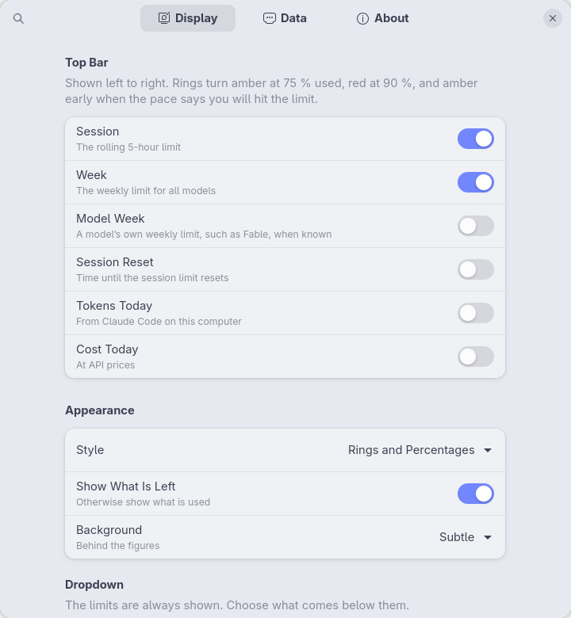
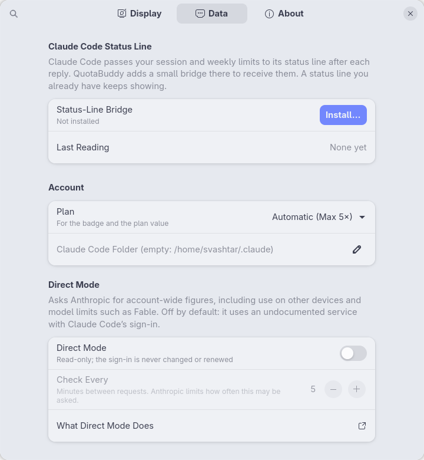

<p align="center">
  
</p>

# QuotaBuddy

**Your Claude usage limits in the GNOME top bar: the 5-hour session and the weekly limit as small rings, with the full picture one click away.**

[](https://release.gnome.org/51/)
[](LICENSE)
[](https://github.com/Svashtar/quotabuddy-gnome/actions/workflows/ci.yml)

> **Status: early development.** There is no release yet. Follow the [changelog](CHANGELOG.md) for progress.

<p align="center">
  
</p>

## Introduction

Claude's Pro and Max plans come with a rolling **5-hour session** limit and a **weekly** limit, and some plans add a weekly limit for one model, such as Fable. Claude Code shows them when you type `/usage`. QuotaBuddy keeps them in view:

- **In the top bar**, a pill with one small ring and a percentage per limit. It shows what is left (or what is used, if you prefer), and turns amber, then red, as you get close.
- **In the dropdown**, large rings with reset countdowns and an even-pace marker, a forecast of whether you will reach the limit before it resets, activity charts by model, what your use would cost at API prices, and your busiest projects.

## Why?

- **No surprises.** Running into a limit halfway through a task is annoying. A glance at the top bar tells you how much is left and when it comes back.
- **Pace, not just numbers.** "62 % left" means something different an hour into a session than four hours in. QuotaBuddy compares your use with an even pace and says when you would reach the limit at your current rate.
- **Know your plan's value.** The cost section shows what the same use would cost at Anthropic's API list prices.
- **Made for GNOME 51 and later**, with the same care as the other *Buddy* extensions.

## Features

- **Top-bar figures you choose:** session, week, a model's own weekly limit (such as Fable), time to the session reset, tokens today, cost today.
- **Four styles:** rings and percentages, bars and percentages, rings only, text only. Pill background none, subtle or your accent colour.
- **Colour that warns early:** amber at 75 % used, red at 90 %, and amber as soon as the pace says you will reach the limit before it resets.
- **Dropdown sections** (each can be turned off): pace forecast, activity for the last 24 hours or 7 days stacked by model, cost at API prices (today, 7 days, this month, and how that compares with your plan's price), busiest projects and session, cache use.
- **Plan badge:** Pro, Max 5×, Max 20×, read from Claude Code's sign-in, or chosen by hand.
- **Two ways to get your limits:** direct mode (recommended) for current, account-wide figures, or a small status-line bridge for Claude Code that uses no network, installed after showing exactly what changes.
- **Long history:** QuotaBuddy keeps its own daily summary of your use, so charts and costs survive Claude Code's 30-day log cleanup.
- **Light on the system:** Claude Code's logs (hundreds of megabytes a week) are read in a separate process, and only what is new since the last read.
- **Helpful About page:** release notes, links to the docs, settings export/import and a *Copy Debug Info* button for bug reports.

## Screenshots

<p align="center">
  
</p>

## Requirements

- **GNOME Shell 51 or later.**
- **[Claude Code](https://code.claude.com)** on this computer, signed in with a Claude Pro or Max plan. QuotaBuddy reads what Claude Code already knows; it never signs in on its own.

## Installation

### From extensions.gnome.org

*Coming soon.*

### From a release zip

1. Download `quotabuddy@svashta.com.shell-extension.zip` from the [latest release](https://github.com/Svashtar/quotabuddy-gnome/releases/latest).
2. Install it:

   ```sh
   gnome-extensions install --force quotabuddy@svashta.com.shell-extension.zip
   ```

3. Log out and back in (on Wayland GNOME Shell can't be restarted in place).
4. Enable it:

   ```sh
   gnome-extensions enable quotabuddy@svashta.com
   ```

### From source

You need `git`, `make` and `glib-compile-schemas`.

```sh
git clone https://github.com/Svashtar/quotabuddy-gnome.git
cd quotabuddy-gnome
make install
```

`make install` symlinks `src/` into `~/.local/share/gnome-shell/extensions/quotabuddy@svashta.com`. Log out and back in, then run `gnome-extensions enable quotabuddy@svashta.com`. To remove it again, run `make uninstall`.

## Quick start

1. **Open the settings** (right-click the pill → Settings) and go to the **Data** page.
2. **Turn on direct mode** (recommended). Read what it does, then click *Turn On*; the rings fill in within seconds.
   Or, to use no network, **install the status-line bridge** instead: its figures only update after replies in Claude Code in a terminal.
3. *Optional:* on the **Display** page, choose other figures, a different style, or what is left versus used.

Activity, cost and projects work straight away: they come from Claude Code's logs. The full walk-through is in [Getting started](docs/getting-started.md).

## Documentation

| Guide | What it covers |
|---|---|
| [Getting started](docs/getting-started.md) | Setup, what each figure means, the dropdown, direct mode |
| [Troubleshooting](docs/troubleshooting.md) | No figures, old figures, wrong plan, collecting logs |
| [Privacy](docs/privacy.md) | What QuotaBuddy reads, stores and sends, and what direct mode does |
| [Architecture](docs/architecture.md) | How the extension is built (for contributors) |

## FAQ

**Where do the limits come from?**
With direct mode (recommended), from Anthropic every few minutes, for your whole account. Without it, from Claude Code's status line, which only gets new figures after replies in Claude Code in a terminal: not from the desktop app, other devices or claude.ai.

**I also use the desktop app, my laptop or claude.ai. Are the figures right?**
With direct mode, yes. With the status line only, the figures are as old as your last terminal reply on this computer; the dropdown shows their age and says when they are out of date. Activity, cost and projects come from Claude Code's logs on this computer, desktop app included.

**Why is there no "Sign in with Claude"?**
Anthropic offers no sign-in for other apps to read subscription usage. QuotaBuddy uses what Claude Code already writes on your computer.

**Is the cost what I pay?**
No. Subscriptions are not billed per token. The cost section shows what the same tokens would cost at Anthropic's API list prices, for comparison.

**Where is the Fable limit?**
Claude Code's status line only reports the session and week. A model's own weekly limit shows up with direct mode, when your plan has one.

## Privacy

QuotaBuddy has no telemetry and, by default, makes no network connections. It reads Claude Code's status line, logs and the plan name from its sign-in file, and keeps a summary of your use on this computer. Direct mode, if you turn it on, sends Claude Code's sign-in to `api.anthropic.com` only. Details are in [Privacy](docs/privacy.md).

## Contributing

Bug reports and pull requests are welcome. Please read [CONTRIBUTING.md](CONTRIBUTING.md) first. When reporting a bug, open **Settings → About → Copy Debug Info** and paste the result into the [bug report form](https://github.com/Svashtar/quotabuddy-gnome/issues/new/choose).

## Translations

QuotaBuddy is in English only. Every string is ready for gettext ([`po/quotabuddy.pot`](po/quotabuddy.pot)), so if you'd like it in your language, see [CONTRIBUTING.md → Translations](CONTRIBUTING.md#translations).

## License

QuotaBuddy is free software, released under the [GNU General Public License, version 2 or later](LICENSE) (GPL-2.0-or-later). It is not affiliated with Anthropic; Claude is a trademark of Anthropic.

---

<p align="center">
  <a href="https://svashta.com">
    <picture>
      <source media="(prefers-color-scheme: dark)" srcset="docs/assets/svashta-wordmark-light.svg">
      
    </picture>
  </a>
  <br><sub>Made by <a href="https://svashta.com">Svashta</a></sub>
</p>
